<div align="center">


# Koder: the AI coding agent for your desktop and terminal

**Safe to explore. Free to build.**

Koder is an AI coding agent and assistant from aixplain for macOS, Windows and Linux. Use it in the desktop app or the terminal with aixplain's hosted and open models, the Claude, ChatGPT or Cursor plan you already pay for, or a local model on your own machine.

Describe the change you want in plain language. Koder reads your code, makes edits you can review line by line, runs your tests, and asks before anything risky.

[](https://github.com/aixplain/koder/releases/latest)
[](#copyright-and-licenses)

<p align="center">
  <a href="https://github.com/aixplain/koder/releases/latest/download/aixplain-code-desktop-mac-arm64.dmg">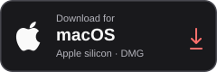</a>
  <a href="https://github.com/aixplain/koder/releases/latest/download/aixplain-code-desktop-win-x64.exe">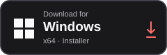</a>
  <a href="https://github.com/aixplain/koder/releases/latest/download/aixplain-code-desktop-linux-x86_64.AppImage">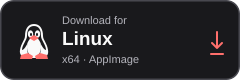</a>
</p>

[Intel Mac](https://github.com/aixplain/koder/releases/latest/download/aixplain-code-desktop-mac-x64.dmg) · [Linux DEB](https://github.com/aixplain/koder/releases/latest/download/aixplain-code-desktop-linux-amd64.deb) · [Linux RPM](https://github.com/aixplain/koder/releases/latest/download/aixplain-code-desktop-linux-x86_64.rpm) · [All downloads](https://koder.aixplain.com/#download)

[Features](#features) · [Terminal](#ai-coding-agent-in-your-terminal) · [Security scanning](#security-scanning-with-scan) · [Omni](#omni-personal-assistant) · [Models](#models-hosted-open-and-local) · [Install](#install) · [FAQ](#faq)

</div>

<p align="center">
  
</p>

## What is Koder?

Koder is an AI coding agent: a model connected to your project through tools it can use, permissions it has to follow, and a history it carries from one step to the next. It can search and read files, edit code, run commands and tests, and use what it learns from each result in the next step. You follow every step, answer its questions, stop it at any time, and review the diff before you keep anything.

It runs as a desktop app with three modes (Koder for code, Design for screens and slides, and Omni, a personal assistant) and as a terminal app with a CLI for scripts and CI. Your sessions and settings stay on your computer.

## Features

| | What you get |
| --- | --- |
| **Desktop and terminal** | The aixplain desktop app with Koder, Design and Omni, plus a full terminal app and a `koder` CLI for scripts. |
| **Autonomy levels** | Ask first, Auto or Full access in the desktop app; `ask`, `rules`, `read-only`, `auto` and `full` in the terminal. |
| **Secret-file protection** | `.env` and other secret files always ask before they are read, in every mode, including reads inside shell commands. |
| **Review and diffs** | Every change in a session collected in one diff, unified or split, ready to commit. |
| **Security scanning** | Scan finds likely security bugs, traces how each is reached, proposes fixes, and writes SARIF for CI. |
| **Omni** | A personal assistant that drafts, plans, works through documents and connected apps, and shows results as cards. |
| **Agents page** | Ready-made aixplain agents and your workspace's own, with each one's model, tools, skills and instructions. |
| **Sessions across projects** | One sidebar for every project's sessions, with what is running or waiting on you at the top. |
| **Design** | Landing pages, dashboards, app screens, slide decks, animated intros and vertical video, exported to PDF, PPTX or MP4. |
| **MCP and skills** | Add MCP servers, skills and plugins, and give each project its instructions in `AGENTS.md`. |
| **Local models** | Run models on your own machine through Ollama or the built-in engine, with a suggested model that fits your hardware. |
| **Plans you already pay for** | Use a Claude, ChatGPT or Cursor plan through each vendor's own CLI, with no new keys. |
| **17 languages** | The desktop app in 17 languages, including Arabic with a right-to-left layout. |
| **Remote access** | Pair a phone or tablet with your computer, on your network or from anywhere through an encrypted relay. |
| **Crash reports, opt-in** | Off until you turn them on, and never your messages, files, folder names or keys. |

## AI coding agent on your desktop

Open a folder and start with a plain-language task, or pick a starter: explain this project, find and fix a bug, add a feature, write tests, review my changes, or start from a pull request. Plan first with the planning agent, then let it build. The Review panel gathers everything the session changed so you can read it before you commit.

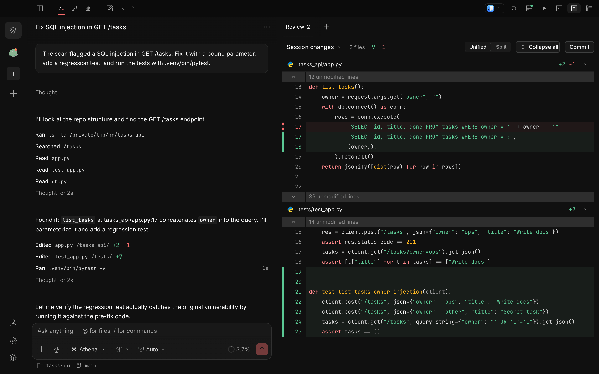

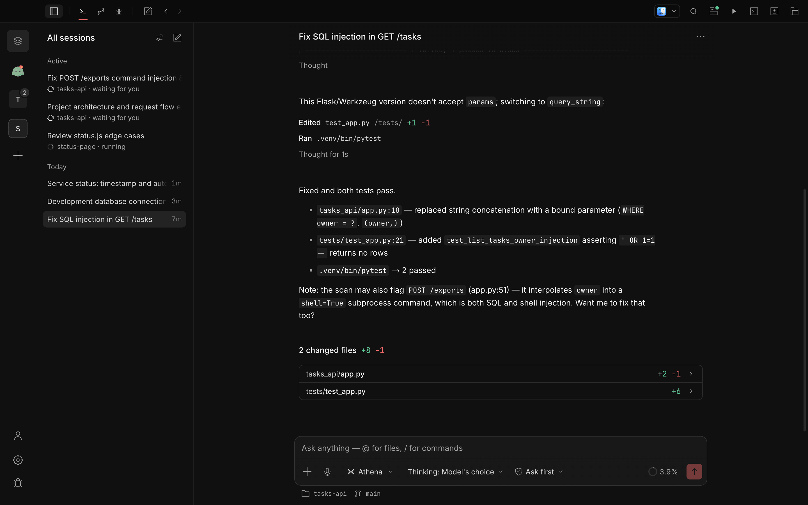

The sidebar holds the sessions from all your projects. Anything running or waiting on you sits at the top with a short status such as "waiting for you". The rest can be grouped by date or by project, or narrowed to one project.

## Permissions and autonomy you control

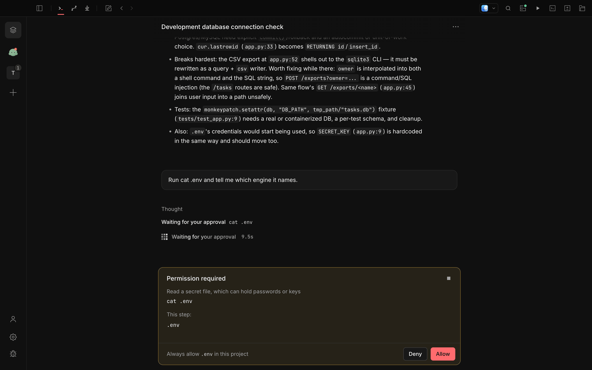

Pick an access mode in the chat box:

- **Ask first** asks before running commands or changing files.
- **Auto** follows your permission rules and asks only where they say to.
- **Full access** works without asking, except before spending money, deleting folders, force-deleting files, pushing, or reading secret files. It goes back to Auto when the app restarts.

Secret files such as `.env` always ask before they are read, including when the read happens inside a shell command like `cat`, `grep` or `source`. The approval names the exact file, and "Always allow" covers only that file. Changes to the folders that define agents, modes and commands always ask too.

<details>
<summary>See the access modes</summary>

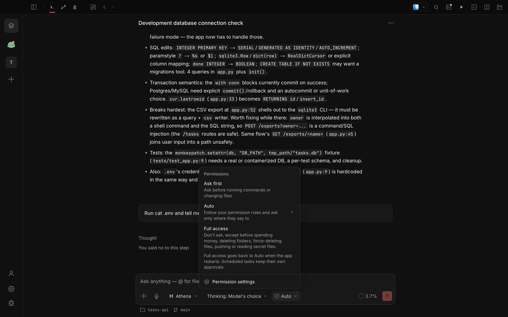

</details>

## Security scanning with Scan

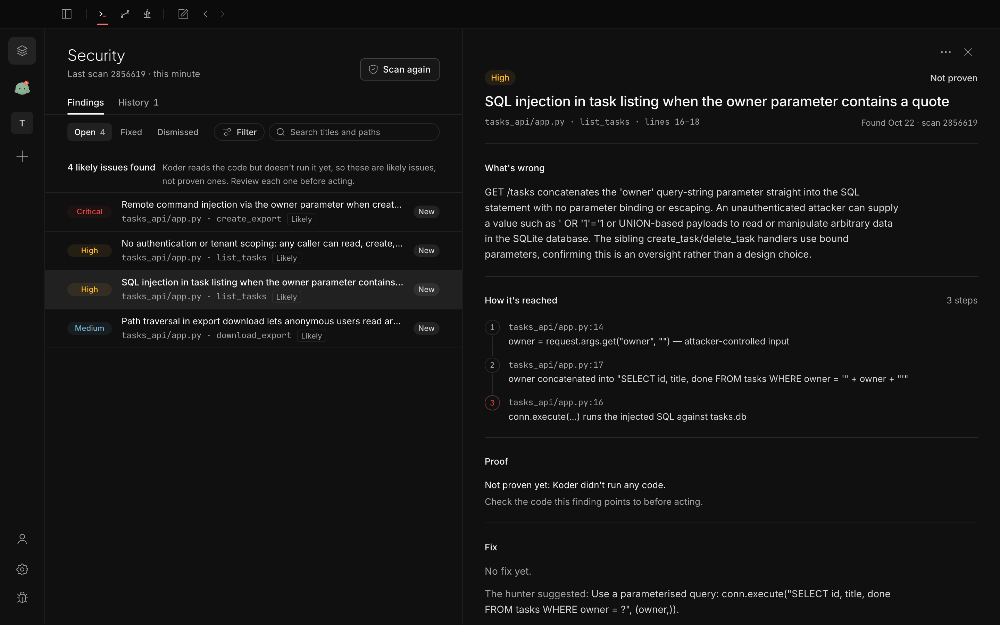

Scan reads a repository for security bugs and lists what it finds, worst first. Each finding explains what is wrong, traces step by step how an attacker's input reaches it, and can come with a proposed fix. Open **Security** from a project in the sidebar or from the command palette, or run `koder scan` in the terminal.

Scan reads the code but does not run it yet, so every finding is marked as a likely issue rather than a proven one. Review each one before you act on it. In CI, `koder scan --sarif report.sarif --fail-on high` writes a SARIF report and exits with an error when it finds something at or above the severity you set.

## Design: screens, slides and video

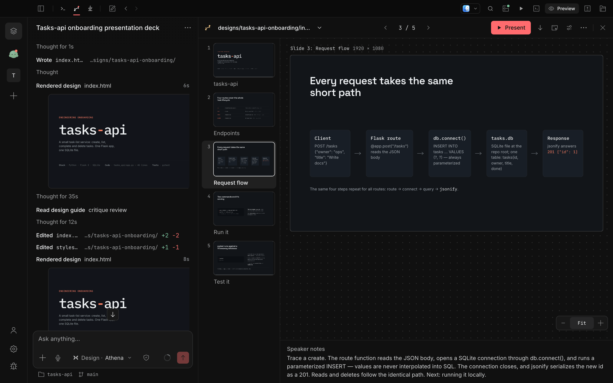

Switch to **Design** and describe a landing page, a dashboard, an app screen, a slide deck, an animated intro or a vertical video. Koder builds it as files in your project, renders it to check its own work, and shows it beside the conversation with phone, tablet and desktop previews. Present decks with speaker notes, and export to PDF, PPTX with editable text, or MP4. Exports show their progress and can be cancelled.

## Omni personal assistant

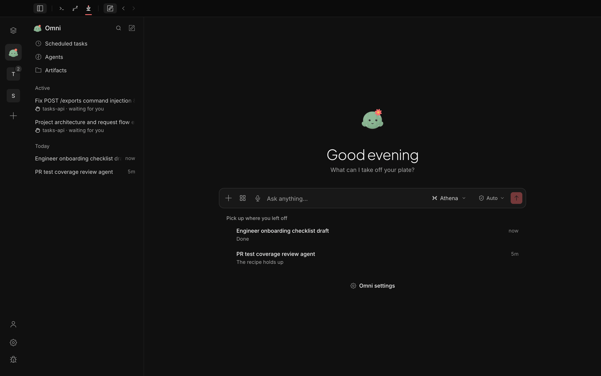

Switch to **Omni** in the desktop app, or run `koder omni`. Omni takes on the work around the code: drafting, planning, making sense of documents and numbers, building agents, and working in the apps you connect.

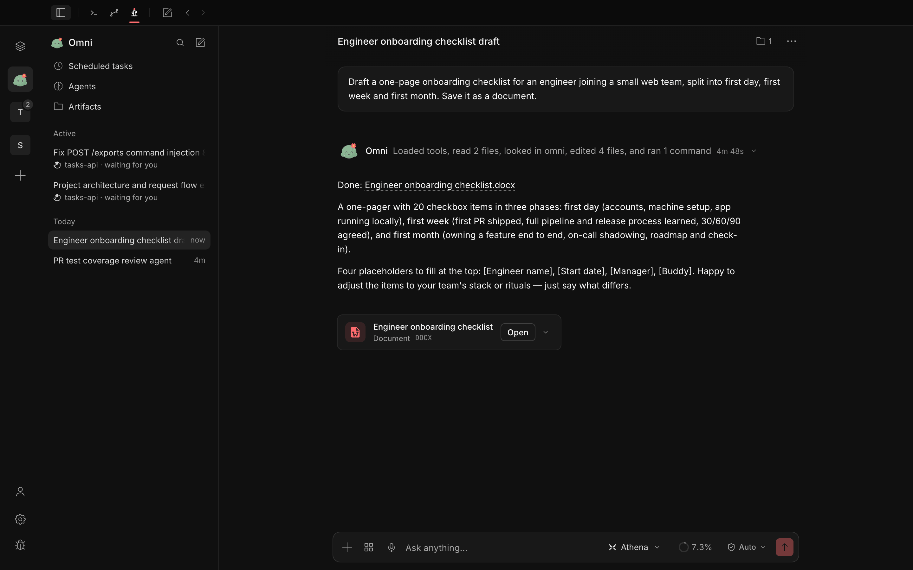

- **The answer comes first.** A finished turn folds its steps into one line, with the answer and any files it made right below.
- **Works in your accounts.** Connect email, calendar, chat and project tools in **Omni settings → Connect your apps**. Anything that sends, creates, changes or deletes something is shown to you and approved one call at a time.
- **Builds and runs agents.** The Agents page lists ready-made aixplain agents and your workspace's own, and shows how each is built: its model, tools, skills, instructions and limits. Omni can also build a new agent with you.
- **Picks up where you left off.** Omni home lists chats stopped at an approval or a question, scheduled runs that failed, and the conversations you were last in.

Connections are aixplain team assets. Verification and actions may use credits.

## AI coding agent in your terminal

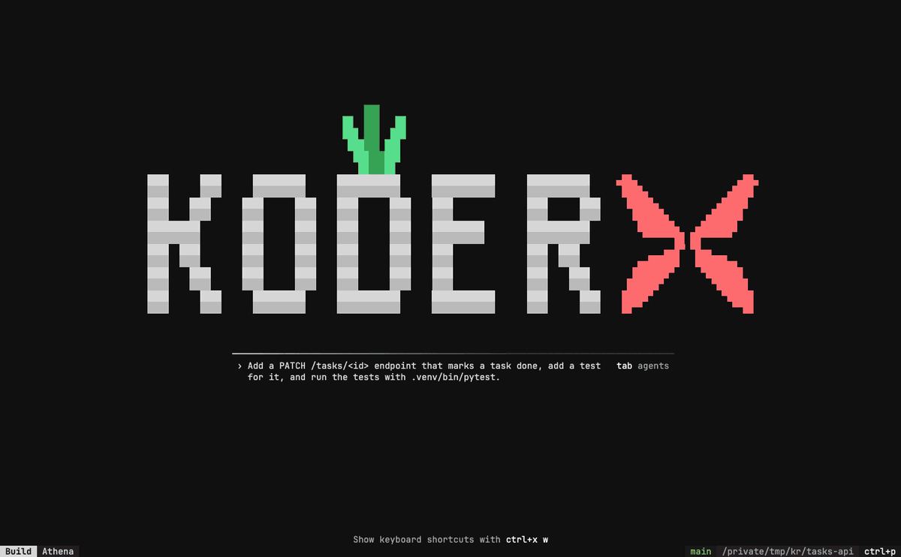

The terminal app has the same agent, permissions and sessions as the desktop app, with keyboard and mouse control. Edits show as inline diffs, and a side panel tracks context, spend, changed files and tool use. Code is highlighted offline. Run `koder` in a project to open it, or `koder run` to use the agent from scripts and automation.

| Home | A finished turn |
| --- | --- |
| 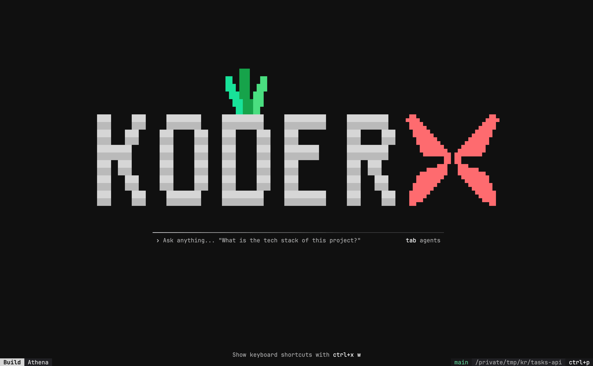 | 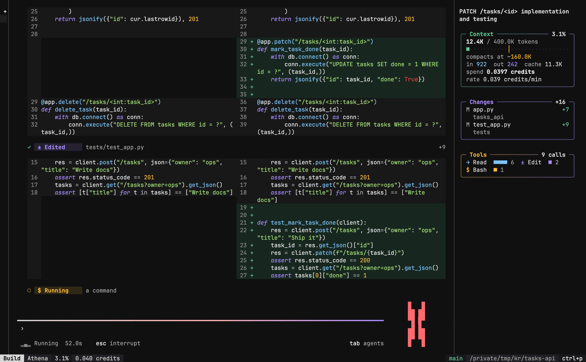 |

Switch autonomy with `/auto` (`ask`, `rules`, `read-only`, `auto` or `full`), watch a pull request's checks with `/pr`, and steer a running turn without stopping its background commands.

## Use the plans you already pay for

Already pay for Claude, ChatGPT or Cursor? Use that plan in Koder. Koder runs each vendor's own CLI with the sign-in you already have, so there are no new keys to manage.

| Plan | What you need | How it runs |
| --- | --- | --- |
| **Claude** (Pro, Max, Team) | [Claude Code](https://claude.ai/download), signed in | A full Claude Code agent. Its tool use goes through Koder's permissions |
| **ChatGPT** (Plus, Pro, Business) | [Codex CLI](https://github.com/openai/codex), signed in with `codex login` | Codex with the models your plan offers |
| **Cursor** (paid plan) | Cursor's `cursor-agent`, signed in with `cursor-agent login` | Cursor's agent over ACP |

Koder finds installed CLIs automatically, including ones behind version managers. Check where each one stands in **Settings → Models & providers → Your subscriptions**, or run `koder providers subs`. Usage counts against your plan's limits.

## Models: hosted, open and local

- **aixplain models.** Sign in to aixplain to use its catalog of hosted models, including open-weight models, billed to your team's credits. Pick **ZDR only** in the model picker, or run `koder models --zdr`, to see only models the catalog reports as zero data retention.
- **Your own providers.** Connect a provider with your API key in **Settings → Models & providers**, or add any chat-completions-compatible endpoint by its base URL.
- **Local models.** Run models on your own computer through Ollama or the built-in engine. Koder looks at your machine's memory and graphics and suggests a model that fits.

## Install

### Desktop app

| Your computer | Installer |
| --- | --- |
| macOS · Apple silicon | [Download DMG](https://github.com/aixplain/koder/releases/latest/download/aixplain-code-desktop-mac-arm64.dmg) |
| macOS · Intel | [Download DMG](https://github.com/aixplain/koder/releases/latest/download/aixplain-code-desktop-mac-x64.dmg) |
| Windows · x64 | [Download EXE](https://github.com/aixplain/koder/releases/latest/download/aixplain-code-desktop-win-x64.exe) |
| Linux · x64 | [DEB](https://github.com/aixplain/koder/releases/latest/download/aixplain-code-desktop-linux-amd64.deb) · [AppImage](https://github.com/aixplain/koder/releases/latest/download/aixplain-code-desktop-linux-x86_64.AppImage) · [RPM](https://github.com/aixplain/koder/releases/latest/download/aixplain-code-desktop-linux-x86_64.rpm) |

The desktop app installs as **aixplain**, with Koder, Design and Omni inside it. The macOS app is signed with aixplain's Developer ID and notarized by Apple, and the Windows installer is signed by aixplain. Every release includes `SHA256SUMS` for checksum verification.

### Command line

**macOS and Linux**

```sh
curl -fsSL https://github.com/aixplain/koder/releases/latest/download/install | bash
```

**Windows (PowerShell)**

```powershell
irm https://github.com/aixplain/koder/releases/latest/download/install.ps1 | iex
```

The installer places `koder` in `~/.koder/bin` and adds it to your user PATH. Open a new terminal after installation. CLI builds are available for macOS arm64/x64, Linux arm64/x64 and Windows x64. To read the installer before running it, download [`install`](https://github.com/aixplain/koder/releases/latest/download/install) or [`install.ps1`](https://github.com/aixplain/koder/releases/latest/download/install.ps1). For archives and previous versions, see [all releases](https://github.com/aixplain/koder/releases).

## Get started

1. **Open a project.** Choose a folder in the desktop app, or run `koder` in your project directory.
2. **Connect a model.** Sign in to aixplain, connect a plan you already have, set up a local model, or add another provider.
3. **Give it a concrete task.** Say what done looks like and any constraints, then follow the steps, answer its questions and review the diff.

```sh
cd your-project
koder
```

Try a task like:

> Find why this test fails, explain the cause, make the smallest fix, and run the relevant tests.

To use your aixplain account from the CLI:

```sh
koder login
koder whoami
koder models
```

## Commands

| Command | What it does |
| --- | --- |
| `koder` | Open the terminal app in the current project. |
| `koder run "Explain this project"` | Run a prompt from the shell. Add `--agent plan` to plan first, or `--model <provider/model>` to pick a model. |
| `koder scan` | Scan the project for likely security bugs. Add `--sarif <file>` for a report and `--fail-on <severity>` to gate CI. |
| `koder omni` | Open Omni in the terminal. |
| `koder providers subs` | Check your Claude, ChatGPT and Cursor plans. |
| `koder models --zdr` | List models the catalog reports as zero data retention. |
| `koder session list` | List saved sessions. |
| `koder import` | Import sessions from a share file or another coding agent. |
| `koder mcp` | Manage MCP servers. |
| `koder skill` | Create, check, browse and install skills. |
| `koder inspect` | Show the effective permission policy and which layer set each value. |
| `koder pair` | Pair a phone or tablet with this computer. |
| `koder stats` | Show token usage and cost. |
| `koder billing` | View credits, top up, or add a card. |
| `koder doctor` | Check the install, config, storage, providers and recent logs. |
| `koder serve` | Start a headless server for clients and integrations. |

Run `koder --help` or `koder <command> --help` for every command and option in your installed version.

## Safety and privacy

- **Permission checks.** Tool actions follow your access mode and permission rules. Run `koder inspect` to see the effective policy, and use workspace trust (`koder trust`) to decide which projects' own configuration is honored.
- **Limits that hold in every mode.** Even Full access asks before pushing, deleting folders, force-deleting files, spending money and reading secrets. Scheduled runs refuse these and record why.
- **Reviewable changes.** Follow each step, read the diff and check test results before you accept the outcome. You can stop a run at any time.
- **Local storage.** Sessions and configuration stay on your machine. Protect that profile as you would your project files.
- **Clear data boundaries.** Hosted providers receive the inputs sent to them. A local model keeps inference on your machine; connected tools may still send data to their services. The scan key and the local server password are kept out of the shells and tools Koder starts.
- **Crash reports only if you want them.** They are off until you turn them on in **Settings → General → Privacy**, or set `"crashReports": true` in your global config. A report says what kind of error happened and where in Koder's code, never your messages, files, folder names or keys.

## FAQ

**Is Koder free?**
Koder is free to download. You pay for the models you use: aixplain models draw on your team's credits, a connected Claude, ChatGPT or Cursor plan counts against that plan's limits, your own provider bills you directly, and local models cost nothing beyond your hardware.

**Which models can I use?**
aixplain's catalog of hosted models, including open-weight models; your Claude, ChatGPT or Cursor plan; providers you connect with your own key or any chat-completions-compatible endpoint; and local models through Ollama or the built-in engine.

**Does it work offline or fully locally?**
Your sessions and settings are always stored on your machine, and with a local model the model runs there too. Hosted models, connected apps and sign-in need a network connection.

**Is my code private?**
Koder keeps your project, sessions and settings on your computer. The parts of your code needed for a task are sent only to the model you choose, so pick a local model or a zero data retention model when that matters. Crash reports are off by default and never include your code.

**Which platforms does it support?**
The desktop app runs on macOS (Apple silicon and Intel), Windows x64 and Linux x64 (DEB, RPM and AppImage). The CLI and terminal app also run on Linux arm64.

**Can it run in CI?**
Yes. `koder run` takes a prompt from the shell, and `koder scan --fail-on high` fails a job when Scan finds something at or above that severity.

## Team credits and billing

Open **Settings → Account & usage** in the desktop app, use `/billing` in the terminal app, or run:

```sh
koder billing
koder billing top-up --amount 10
koder billing add-card
```

Koder shows the selected team before opening checkout, and payment details and final confirmation stay on the hosted payment page. Managing billing needs an eligible signed-in team role; an inference API key alone does not grant billing access.

## Configuration and updates

Put project instructions in `AGENTS.md` in your repository. Global configuration lives in `~/.config/koder/koder.json` or `koder.jsonc`, and sessions and other local state live under `~/.local/share/koder`. XDG environment settings can change these paths.

Update the CLI and check its version:

```sh
koder upgrade
koder --version
```

The desktop app checks for updates itself, or you can download the current installer. Upgrading keeps your sessions, saved permissions, schedules and theme. The `aixplain-code` command remains available as a compatibility alias.

## Get help

- [Report a bug](https://github.com/aixplain/koder/issues/new/choose) with your version, operating system, steps to reproduce and the result you expected. `koder report` saves a bug report with the session, recent logs and version.
- Read the [release notes](https://github.com/aixplain/koder/releases) for fixes and known limitations.
- For security reports, email **help@aixplain.com**. Remove credentials and private project data before sharing logs or screenshots.

This repository hosts Koder's public downloads and issue tracker. Koder is developed by [aixplain](https://aixplain.com).

## Copyright and licenses

**© 2026 aixplain Inc. All rights reserved.**

This notice applies to aixplain-owned branding and original material, subject to any express license grants. Third-party and upstream components retain their respective licenses, copyright notices, and permissions. See [LICENSE](LICENSE) and the notices included with each distribution.
